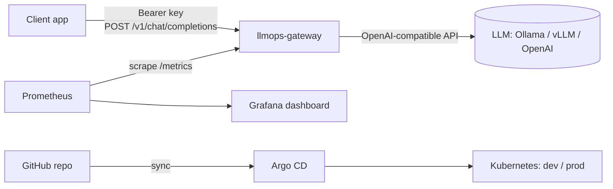

# llmops-gateway

[](https://github.com/PedroCastro0507/llmops-gateway/actions/workflows/ci.yml)

An OpenAI-compatible gateway that puts **operations around an LLM**: API-key auth, request guard rails, Prometheus metrics for latency, tokens and cost, a Grafana dashboard, and a GitOps deployment to Kubernetes with Argo CD. The model behind it is swappable: a local model through [Ollama](https://ollama.com), any OpenAI-compatible server (vLLM, OpenAI), or a built-in mock for CI.



## Why

Teams adopting LLMs need the same things any production service needs: who is calling, how slow it is, how many tokens it burns, what it costs, and a repeatable way to deploy it. This project is a small, working example of that platform layer.

## Features

| Area | What it does |
| --- | --- |
| API | `POST /v1/chat/completions` (OpenAI request/response shape), `GET /healthz`, `GET /readyz`, `GET /metrics` |
| Security | Bearer API keys (constant-time compare), prompt size limit, output token cap, prompts never logged, non-root read-only container, all Linux capabilities dropped, secrets injected from Kubernetes Secrets |
| Observability | `llm_requests_total`, `llm_request_duration_seconds`, `llm_tokens_total`, `llm_cost_usd_total`, `llm_inflight_requests`; provisioned Grafana dashboard |
| Delivery | Kustomize base + dev/prod overlays (prod: 2+ replicas, HPA, PodDisruptionBudget), Argo CD Applications with automated sync, prune and self-heal |
| CI (GitHub Actions) | ruff lint (incl. bandit security rules), pytest, pip-audit, kubeconform schema validation, image build, Trivy scan with a CRITICAL gate, container smoke test, push to GHCR |

## Run locally

**Python only (mock model, no downloads):**

```bash
pip install -r requirements-dev.txt
uvicorn app.main:app --reload
curl -s localhost:8000/v1/chat/completions -H 'content-type: application/json' \
  -d '{"messages":[{"role":"user","content":"hello"}]}'
```

**Full stack with a real local model (Docker Compose):**

```bash
docker compose up -d --build
docker compose exec ollama ollama pull llama3.2:1b
curl -s localhost:8000/v1/chat/completions \
  -H 'Authorization: Bearer local-dev-key' -H 'content-type: application/json' \
  -d '{"messages":[{"role":"user","content":"Explain GitOps in one sentence."}]}'
```

Grafana: http://localhost:3000 (dashboard "LLMOps Gateway"). Prometheus: http://localhost:9090.

## Deploy to Kubernetes with Argo CD

```bash
# 1. Secrets are created out-of-band, never committed
kubectl create namespace llm-prod
kubectl -n llm-prod create secret generic llmops-gateway-secrets \
  --from-literal=GATEWAY_API_KEYS="$(openssl rand -hex 24)"

# 2. Register the apps; Argo CD keeps the cluster in sync with Git
kubectl apply -n argocd -f argocd/applications/
```

`dev` runs the mock backend (no GPU or model needed). `prod` switches to `BACKEND=openai` and expects an OpenAI-compatible service at `UPSTREAM_BASE_URL` (default `http://ollama:11434/v1`).

## Configuration

| Variable | Default | Purpose |
| --- | --- | --- |
| `BACKEND` | `mock` | `mock` or `openai` (any OpenAI-compatible API) |
| `UPSTREAM_BASE_URL` | `http://ollama:11434/v1` | Model server URL |
| `UPSTREAM_API_KEY` | empty | Key for the model server, if it needs one |
| `DEFAULT_MODEL` | `llama3.2:1b` | Used when the request omits `model` |
| `GATEWAY_API_KEYS` | empty (auth off) | Comma-separated client keys |
| `MAX_PROMPT_CHARS` / `MAX_OUTPUT_TOKENS` | `16000` / `1024` | Guard rails |
| `PRICE_PER_1K_PROMPT_USD` / `PRICE_PER_1K_COMPLETION_USD` | `0` | Cost estimate for paid APIs |

## Limits and next steps

- CI proves the code, the image and the manifests; it does not deploy to a live cluster.
- No streaming responses yet.
- Next: per-key rate limiting, OpenTelemetry tracing, External Secrets Operator, image signing with cosign, automated image-tag bump in the dev overlay.

## License

MIT
